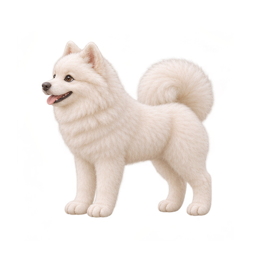

# CuteDog

CuteDog 是一只 Android 桌面萨摩耶。可以轻抚、喂零食、投球、让它陪伴待办。当前动作预览版为 **0.2.1-preview.3**，支持 Android 8.0 及以上。



小狗住在桌面的悬浮窗中，日常走路或慢跑，追球有独立动作。共保留 56 项动作、4,150 张播放帧，以 24 fps 播放。[动作制作与校验](art/live2d/review2/integration/README.md)

## 使用

- 在「小狗」页授权悬浮窗并召唤桌宠。轻点可以抚摸，长按可以拖动。双击小狗可选择喂零食、玩球、聊天等互动，轻点菜单外即可收起。
- 双击菜单和聊天输入栏都有麦克风。按住说普通话，松手发送，滑出按钮取消。首次授予麦克风权限后要再按一次。本机把录音转成文字，语音提问的回复会用内置的萨摩耶音色读出。
- 在「事项」页创建待办并设置到期时间。小狗身旁只显示到点的待办提醒，直接勾选即可完成。通知权限与精确闹钟授权影响送达方式。[提醒与重复规则](docs/reminders.md)
- 「陪伴」可配置支持 OpenAI 兼容接口的 HTTPS 服务和自己的密钥。聊天需要联网，待办、桌宠和每日短句可离线使用。[模型服务与记忆设置](docs/ai-design.md)

## 构建

安装 JDK 17、Android SDK Platform 35、Build-Tools 35.0.0 和 Python 3.11 或以上版本。在 Windows 项目根目录运行：

```powershell
python -m pip install -r scripts/artwork-requirements.txt
.\gradlew.bat -I tools/preview/motion-preview.gradle testDebugUnitTest lintDebug assembleDebug
```

APK 位于 `app/build/outputs/apk/debug/app-debug.apk`。该配置的包名是 `com.cutedog.app.motionpreview`。覆盖升级需使用同一签名。默认 Gradle 配置的包名是 `com.cutedog.app`。[本版设备检查](docs/interaction-review.md)

## 制作资料

[原始设计参考](art/samoyed/) · [Cubism 编辑模型](art/live2d/editor/CuteDog.cmo3) · [Cubism MCP](tools/cubism-mcp/README.md) · [Android 播放资源](app/src/main/assets/pet3d/) · [原始需求](docs/原始需求.md)
